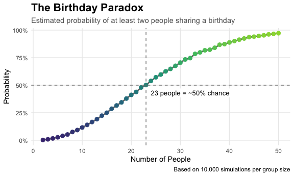
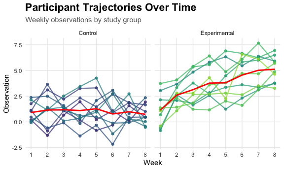
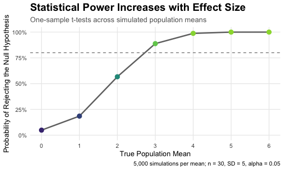
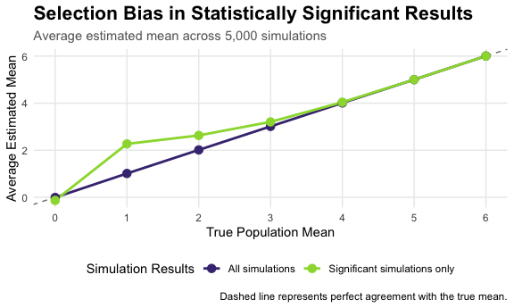

P8105 Homework 5
================
Lina Marcinczyk
2026-11-15

## Problem 1

``` r
birthday_repeated = function(n) {
  birthdays = sample(1:365, size = n, replace = TRUE)

  repeated_birthdays = length(unique(birthdays)) < n

  return(repeated_birthdays)
}
```

``` r
birthday_results_df =
  expand_grid(
    number_of_people = 2:50,
    iter = 1:10000
  ) |>
  mutate(
    repeated = map_lgl(number_of_people, birthday_repeated)
  )
```

``` r
birthday_summary_df =
  birthday_results_df |>
  group_by(number_of_people) |>
  summarize(
    probability = mean(repeated)
  )

birthday_summary_df
```

    ## # A tibble: 49 × 2
    ##    number_of_people probability
    ##               <int>       <dbl>
    ##  1                2      0.0024
    ##  2                3      0.0085
    ##  3                4      0.0167
    ##  4                5      0.0267
    ##  5                6      0.0399
    ##  6                7      0.0521
    ##  7                8      0.0751
    ##  8                9      0.0925
    ##  9               10      0.116 
    ## 10               11      0.139 
    ## # ℹ 39 more rows

``` r
birthday_summary_df |>
  ggplot(aes(x = number_of_people, y = probability)) +
  geom_line(color = "gray45", linewidth = 1) +
  geom_point(
    aes(color = probability),
    size = 2.5
  ) +
  geom_hline(
    yintercept = 0.5,
    linetype = "dashed",
    color = "gray50"
  ) +
  geom_vline(
    xintercept = 23,
    linetype = "dashed",
    color = "gray50"
  ) +
  annotate(
  "label",
  x = 32, y = 0.43,
  label = "23 people = ~50% chance",
  size = 3.5,
  label.size = 0,
  fill = "white"
  ) +
  scale_color_viridis_c(
    option = "D",
    begin = 0.15,
    end = 0.85,
    labels = scales::label_percent()
  ) +
  scale_y_continuous(
    labels = scales::label_percent()
  ) +
  labs(
    title = "The Birthday Paradox",
    subtitle = "Estimated probability of at least two people sharing a birthday",
    x = "Number of People",
    y = "Probability",
    color = "Probability",
    caption = "Based on 10,000 simulations per group size"
  ) +
  theme_minimal() +
  theme(
    plot.title = element_text(face = "bold", size = 16),
    plot.subtitle = element_text(color = "gray40"),
    panel.grid.minor = element_blank(),
    legend.position = "none"
  )
```

    ## Warning in annotate("label", x = 32, y = 0.43, label = "23 people = ~50%
    ## chance", : Ignoring unknown parameters: `label.size`



The estimated probability that at least two people share a birthday
increases rapidly with group size. With only 23 people, the probability
is approximately 50%, and by 50 people, it approaches 97%. Although
there are 365 possible birthdays, a shared birthday becomes likely in
relatively small groups because the number of possible pairs increases
quickly as more people are added. These results illustrate the birthday
paradox.

## Problem 2

``` r
longitudinal_files_df =
  tibble(
    file_name = list.files(
      path = "data",
      pattern = "\\.csv$"
    )
  )
```

``` r
longitudinal_files_df =
  longitudinal_files_df |>
  mutate(
    data = map(
      file_name,
      ~ read_csv(file.path("data", .x), show_col_types = FALSE)
    )
  )
```

``` r
longitudinal_df =
  longitudinal_files_df |>
  unnest(cols = data)
```

``` r
longitudinal_tidy_df =
  longitudinal_df |>
  mutate(
    group = if_else(
      str_starts(file_name, "con"),
      "Control",
      "Experimental"
    ),
    subject_id = str_remove(file_name, "\\.csv$")
  ) |>
  pivot_longer(
    cols = starts_with("week"),
    names_to = "week",
    values_to = "observation"
  ) |>
  mutate(
    week = as.numeric(str_remove(week, "week_"))
  ) |>
  select(subject_id, group, week, observation)
```

``` r
longitudinal_means_df =
  longitudinal_tidy_df |>
  group_by(group, week) |>
  summarize(
    mean_observation = mean(observation),
    .groups = "drop"
  )
```

``` r
longitudinal_tidy_df |>
  ggplot(aes(
    x = week,
    y = observation,
    group = subject_id
  )) +
  geom_line(
    aes(color = subject_id),
    alpha = 0.7,
    linewidth = 0.8
  ) +
  geom_point(
    aes(color = subject_id),
    size = 1.5,
    alpha = 0.8
  ) +
  geom_line(
    data = longitudinal_means_df,
    aes(
      x = week,
      y = mean_observation,
      group = group
    ),
    inherit.aes = FALSE,
    color = "red",
    linewidth = 1
  ) +
  facet_wrap(~ group) +
  scale_color_viridis_d(
    option = "D",
    begin = 0.15,
    end = 0.85
  ) +
  scale_x_continuous(breaks = 1:8) +
  labs(
    title = "Participant Trajectories Over Time",
    subtitle = "Weekly observations by study group",
    x = "Week",
    y = "Observation",
    caption = "Thin colored lines represent individual participants; thick red lines represent group means."
  ) +
  labs(
    title = "Participant Trajectories Over Time",
    subtitle = "Weekly observations by study group",
    x = "Week",
    y = "Observation"
  ) +
  theme_minimal() +
  theme(
    plot.title = element_text(face = "bold", size = 16),
    plot.subtitle = element_text(color = "gray40"),
    panel.grid.minor = element_blank(),
    legend.position = "none"
  )
```



The spaghetti plot shows distinct patterns between the control and
experimental groups over the eight-week study period. The control group
remains relatively stable, with individual observations fluctuating but
no clear overall trend. In contrast, the experimental group shows a
substantial increase in mean observations over time, rising from
approximately 1 at week 1 to just above 5 by week 8. Although individual
trajectories vary, the experimental group demonstrates a consistent
overall upward trend, suggesting a positive association between the
experimental condition and the measured outcome over time.

## Problem 3

``` r
sim_t_test = function(mu) {
  sim_data = tibble(
    x = rnorm(n = 30, mean = mu, sd = 5)
  )

  t.test(sim_data$x, mu = 0) |>
    broom::tidy() |>
    select(estimate, p.value)
}
```

``` r
sim_results_df =
  tibble(
    iter = 1:5000
  ) |>
  mutate(
    results = map(iter, ~ sim_t_test(mu = 0))
  ) |>
  unnest(results)

sim_results_df
```

    ## # A tibble: 5,000 × 3
    ##     iter estimate p.value
    ##    <int>    <dbl>   <dbl>
    ##  1     1  -1.62    0.0545
    ##  2     2  -0.542   0.569 
    ##  3     3  -0.278   0.767 
    ##  4     4  -0.303   0.733 
    ##  5     5   0.406   0.637 
    ##  6     6   0.147   0.881 
    ##  7     7   1.20    0.191 
    ##  8     8  -0.0542  0.957 
    ##  9     9  -0.119   0.878 
    ## 10    10  -1.89    0.0712
    ## # ℹ 4,990 more rows

``` r
sim_results_df |>
  summarize(
    rejection_proportion = mean(p.value < 0.05)
  )
```

    ## # A tibble: 1 × 1
    ##   rejection_proportion
    ##                  <dbl>
    ## 1                 0.05

``` r
sim_all_df =
  expand_grid(
    mu = 0:6,
    iter = 1:5000
  ) |>
  mutate(
    results = map(mu, sim_t_test)
  ) |>
  unnest(results)

sim_all_df
```

    ## # A tibble: 35,000 × 4
    ##       mu  iter estimate p.value
    ##    <int> <int>    <dbl>   <dbl>
    ##  1     0     1   0.669   0.440 
    ##  2     0     2   1.65    0.0529
    ##  3     0     3   0.0481  0.955 
    ##  4     0     4   0.814   0.313 
    ##  5     0     5   0.324   0.761 
    ##  6     0     6   1.03    0.207 
    ##  7     0     7  -0.902   0.314 
    ##  8     0     8   0.445   0.691 
    ##  9     0     9  -0.583   0.527 
    ## 10     0    10   0.738   0.330 
    ## # ℹ 34,990 more rows

``` r
power_df =
  sim_all_df |>
  group_by(mu) |>
  summarize(
    power = mean(p.value < 0.05),
    .groups = "drop"
  )

power_df
```

    ## # A tibble: 7 × 2
    ##      mu power
    ##   <int> <dbl>
    ## 1     0 0.049
    ## 2     1 0.185
    ## 3     2 0.567
    ## 4     3 0.888
    ## 5     4 0.988
    ## 6     5 1.000
    ## 7     6 1

``` r
power_df |>
  ggplot(aes(x = mu, y = power)) +
  geom_line(color = "gray45", linewidth = 1) +
  geom_point(
    aes(color = power),
    size = 3
  ) +
  geom_hline(
    yintercept = 0.80,
    linetype = "dashed",
    color = "gray50"
  ) +
  scale_color_viridis_c(
    option = "D",
    begin = 0.15,
    end = 0.85
  ) +
  scale_y_continuous(
    labels = scales::label_percent(),
    limits = c(0, 1)
  ) +
  scale_x_continuous(breaks = 0:6) +
  labs(
    title = "Statistical Power Increases with Effect Size",
    subtitle = "One-sample t-tests across simulated population means",
    x = "True Population Mean",
    y = "Probability of Rejecting the Null Hypothesis",
    caption = "5,000 simulations per mean; n = 30, SD = 5, alpha = 0.05"
  ) +
  theme_minimal() +
  theme(
    plot.title = element_text(face = "bold", size = 16),
    plot.subtitle = element_text(color = "gray40"),
    panel.grid.minor = element_blank(),
    legend.position = "none"
  )
```



``` r
mean_estimates_df =
  sim_all_df |>
  group_by(mu) |>
  summarize(
    mean_all = mean(estimate),
    mean_rejected = mean(estimate[p.value < 0.05]),
    .groups = "drop"
  )

mean_estimates_df
```

    ## # A tibble: 7 × 3
    ##      mu mean_all mean_rejected
    ##   <int>    <dbl>         <dbl>
    ## 1     0 -0.00808        -0.133
    ## 2     1  1.01            2.27 
    ## 3     2  2.01            2.63 
    ## 4     3  3.01            3.21 
    ## 5     4  4.01            4.04 
    ## 6     5  5.00            5.00 
    ## 7     6  6.00            6.00

``` r
mean_estimates_df |>
  pivot_longer(
    cols = c(mean_all, mean_rejected),
    names_to = "estimate_type",
    values_to = "estimated_mean"
  ) |>
  mutate(
    estimate_type = recode(
      estimate_type,
      mean_all = "All simulations",
      mean_rejected = "Significant simulations only"
    )
  ) |>
  ggplot(aes(
    x = mu,
    y = estimated_mean,
    color = estimate_type
  )) +
  geom_abline(
    slope = 1,
    intercept = 0,
    linetype = "dashed",
    color = "gray50"
  ) +
  geom_line(linewidth = 1) +
  geom_point(size = 3) +
  scale_color_viridis_d(
    option = "D",
    begin = 0.15,
    end = 0.85
  ) +
  scale_x_continuous(breaks = 0:6) +
  labs(
    title = "Selection Bias in Statistically Significant Results",
    subtitle = "Average estimated mean across 5,000 simulations",
    x = "True Population Mean",
    y = "Average Estimated Mean",
    color = "Simulation Results",
    caption = "Dashed line represents perfect agreement with the true mean."
  ) +
  theme_minimal() +
  theme(
    plot.title = element_text(face = "bold", size = 16),
    plot.subtitle = element_text(color = "gray40"),
    panel.grid.minor = element_blank(),
    legend.position = "bottom"
  )
```



### Statistical Power

The simulation results show that statistical power increases as the true
population mean moves farther from the null hypothesis value of zero.
When μ = 0, the rejection proportion is approximately 4.9%, consistent
with the nominal 5% Type I error rate. Power increases to 56.7% at μ = 2
and 88.8% at μ = 3, eventually approaching 100% for larger population
means. This demonstrates that larger effect sizes are easier to detect
when sample size and variability are held constant.

### Comparison of Estimated Means

The average estimated means across all simulations closely match the
true population means, demonstrating that the sample mean is an unbiased
estimator. However, when considering only statistically significant
results, the estimated means tend to overestimate the true mean,
particularly when statistical power is low. For example, when μ = 1, the
average estimate across all simulations is 1.01, compared with 2.27
among significant results. As the true mean increases and power
approaches 100%, this discrepancy becomes smaller. These findings
illustrate how selecting only statistically significant results can
exaggerate estimated effect sizes.
